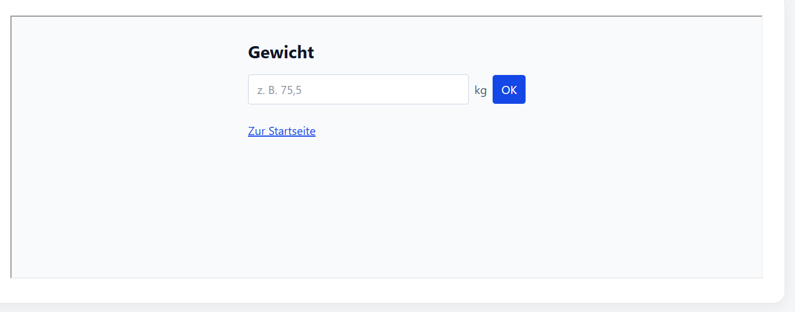

# Gewichtseingabe

Formular zur Eingabe des Körpergewichts in Kilogramm.
Pflichtfeld ab 0,1 kg in Schritten von 0,1 kg; Bestätigung mit „OK“ oder Enter.

Das Absenden wird aktuell nur simuliert. Speicherung und BMI-Berechnung fehlen noch.
Geplant ist `POST /api/weights` mit JSON, z. B. `{"weight": 75.5}`.

## Screenshot
